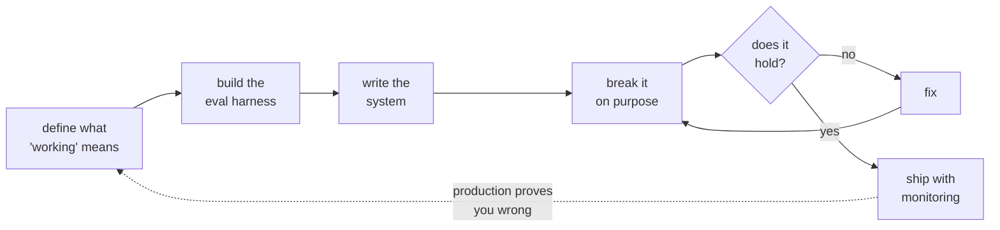

<div align="center">

<picture>
  <source media="(prefers-color-scheme: dark)" srcset="assets/banner-dark.svg">
  
</picture>

<br><br>

[**Portfolio**](https://parth-tiwari-1.vercel.app/) &nbsp;·&nbsp; [**LinkedIn**](https://www.linkedin.com/in/parth-tiwar1) &nbsp;·&nbsp; [**parthti2003@gmail.com**](mailto:parthti2003@gmail.com)

</div>

<br>

> [!NOTE]
> **I build AI systems that know when they're wrong.**
> Most LLM features ship with no measurement, which means they can't be wrong — they can only be vibes. I build the harness that catches the lie first, then the system around it.

<br>

## Selected work

### BeatMind — AI music generation and dissection

**[beatmind.tech](https://www.beatmind.tech)** · live, real users · *private repo, walkthrough on request*

Upload a track; get back an editable arrangement. Separated stems, detected song structure, per-section fragments you can regenerate, repaint and mix down. Built and operated solo.

|  |  |
|---|---|
| **Scale** | ~95,000 lines · a Next.js app on Vercel and four Python workers on Modal |
| **Audio ML** | BS-RoFormer vocals · htdemucs_ft drums and bass · all-in-one-fix structure · essentia key · madmom chords |
| **The hard part** | a fenced, webhook-driven job state machine — dispatch attempt tokens, a reconciler cron, idempotent at-least-once callbacks, because GPU containers are cold, slow and allowed to fail |
| **A decision I measured** | benchmarked L40S vs A100 vs H100 on a pinned seed and **declined the upgrade** — L40S was cheaper *and* faster, because diffusion turned out to be 0.42s of a 16.3s pipeline |

<br>

### [QueryPilot](https://github.com/parthtiwari-dev/querypilot) — self-correcting text-to-SQL agent

[Live API](https://querypilot-backend.onrender.com/docs) · `LangGraph` `FastAPI` `ChromaDB` `PostgreSQL`

Language → schema-aware retrieval → SQL → static validation → a three-stage self-correction loop before anything touches a database.

| Measured on | Result |
|---|---|
| 82-query e-commerce benchmark, first attempt | **90.0%** executed correctly |
| the same 82 queries, after self-correction | **95.7%** |
| tables or columns invented across that run | **none** |
| a separate library schema, zero domain tuning | generalised |

<br>

### [UPI Fraud Engine](https://github.com/parthtiwari-dev/upi-fraud-engine) — real-time fraud decisioning

[Live API](https://upi-fraud-engine.onrender.com/docs) · [Live UI](https://upi-fraud-engine.streamlit.app/) · `XGBoost` `FastAPI` `DuckDB` `Great Expectations`

Built under the constraints a real fraud desk has, not the ones a notebook has: score at time *T* using only pre-*T* features, live inside a **0.5% daily alert budget**, and survive labels that arrive late.

| Measured under | Result |
|---|---|
| a 0.5% daily alert budget | **92.06%** precision |
| the API scoring path | **~386ms** at p95 |
| temporal integrity | **55+** leakage tests |
| replay | day-by-day backtest |

<br>

### [Evidence-Bound Drug RAG](https://github.com/parthtiwari-dev/Evidence-Bound-Drug-RAG) — medical retrieval that refuses

[Live app](https://evidence-bound-drug-rag.streamlit.app/) · [HuggingFace Space](https://huggingface.co/spaces/parthtiwar1/drug-rag-api) · `ChromaDB` `LangChain` `RAGAS`

FDA and NICE source documents, in a domain where a hallucination is patient harm. Every claim carries its citation, and insufficient evidence triggers a refusal instead of a guess.

| Measured on | Result |
|---|---|
| RAGAS faithfulness over answered questions | **~0.99** |
| questions with no supporting evidence | refused, not guessed |
| the full evaluation run | **$0.168** |
| scope | non-diagnostic — not medical advice |

<br>

<div align="center">
<picture>
  <source media="(prefers-color-scheme: dark)" srcset="assets/signal-dark.svg">
  
</picture>
</div>

<br>

## Three things that broke

The work I am proudest of is the bugs I found in my own systems before anyone else did — and I found them because the harness existed first.

<br>

**A fraud model that was lying to itself.**

```
train ROC-AUC      0.895     looked ready to ship
production ROC     0.60      it had been reading the future the whole time
```

Temporal features had bled post-event signal into pre-event training windows. Fixed with point-in-time enforcement and 55+ leakage tests, then rebuilt from scratch. Precision held under a real alert budget, which is the only number that ever mattered.

<details>
<summary><b>Why a backtest is not a train/test split</b></summary>

<br>

A random split asks *can this model separate these rows*. A fraud desk asks *would this model have caught it on the day, knowing only what was knowable then*. Those are different questions, and only one of them predicts production.

The 0.5% alert budget is the part people skip. A fraud model with 99% recall is worthless if it flags 8% of traffic, because no human team can review that. Precision inside a fixed budget is the real constraint — so it became the metric the model was selected on, rather than a number reported afterwards.

</details>

<br>

**A hallucination rate of 100% that was a bug in the metric, not the system.**

`schema_tables_used` was returning `["schema_dict", "tables"]` — the *keys* of a dict, not the table names inside it. Every comparison against the real schema failed, so every query looked like a hallucination. The true rate was 0%. One-line fix.

I only found it because I had written a hallucination detector at all. The sharper lesson is underneath: **your evaluation code is code, and it has bugs.** An eval harness nobody has questioned is just a second thing that can lie to you, with more authority.

<br>

**An LLM answering a revenue question with `SELECT SUM(amount) FROM fines`.**

Two database schemas were sharing one Chroma collection and the embeddings leaked across them, so a question about an e-commerce table retrieved context from a library one. Fixed with prompt isolation and schema-scoped retrieval, then the **entire 82-query benchmark was re-run** rather than spot-checked — because a fix you only test on the failing case is a guess.

<br>

## How I build



The dotted line is the important one. Everything above it is discipline; that one is humility, and it is the only reason the discipline is worth anything.

<br>

<details>
<summary><b>Stack</b></summary>

<br>

**Core** — Python · FastAPI · PostgreSQL · Docker
**AI/ML** — LangGraph · LangChain · RAG · ChromaDB · RAGAS · XGBoost · PyTorch audio models
**Infrastructure** — Modal (GPU) · Vercel · Render · Neon · Cloudflare R2 · GitHub Actions
**Frontend** — TypeScript · Next.js · Vue · Three.js

</details>

<details>
<summary><b>Currently</b></summary>

<br>

AI/ML intern at **Stick and Dot**, building [Vivid](https://parth-tiwari-1.vercel.app/) — creative AI tooling, in beta with real users.

Operating **BeatMind** in production, where the bug reports come from working musicians and are consistently more interesting than anything I would have thought to test.

</details>

<br>

---

<br>

## Working together

**Currently taking on 1–2 freelance projects**, and open to full-time roles.

| | What you get | Timeline | From |
|---|---|---|---|
| **Reliability audit** | I take your RAG or agent, build a real evaluation set against it, and hand you a report: where it fails, how often, and what each fix is worth. | 1 week | $500 |
| **Eval harness + fixes** | The harness above, wired into CI, plus the failures it surfaces actually fixed. | 2–4 weeks | $1,500 |
| **Retainer** | Ongoing evaluation, regression monitoring and iteration as your system and your data drift. | monthly | $1,000/mo |

Bring me a chatbot that invents things · a text-to-SQL feature you cannot trust with a real schema · a model that looked good in the notebook and died in production · an LLM pipeline nobody has ever measured.

**[parthti2003@gmail.com](mailto:parthti2003@gmail.com)** — tell me what is failing and I will tell you, free, whether I think I can fix it.

<br>

<div align="center">
<sub>Bengaluru, India · remote · <a href="https://parth-tiwari-1.vercel.app/">portfolio</a> · <a href="https://www.linkedin.com/in/parth-tiwar1">linkedin</a></sub>
</div>
