

<a href="https://parth-tiwari-1.vercel.app/"></a>

&nbsp;&nbsp;&nbsp;

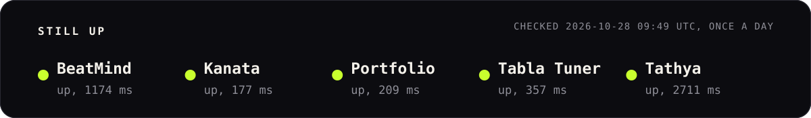

<a href="https://www.beatmind.tech">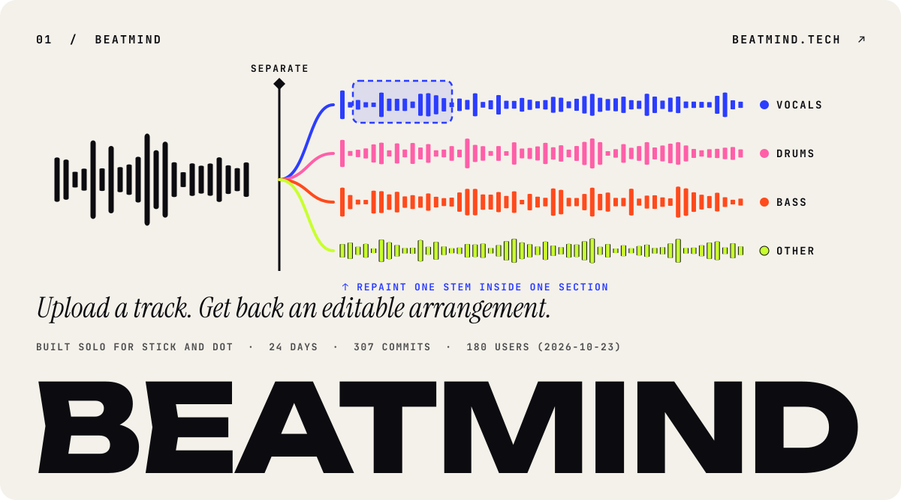</a>

<a href="https://vivid-alpha.vercel.app">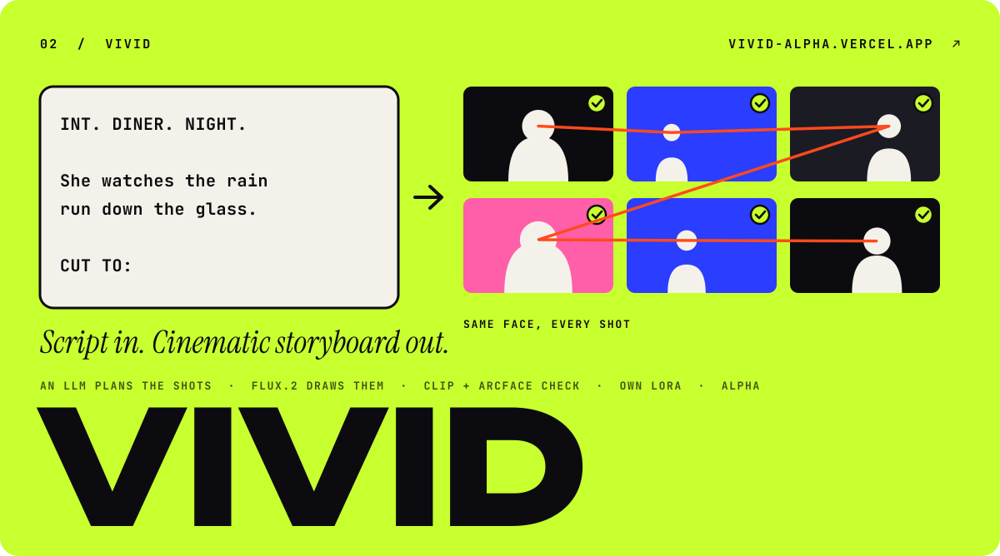</a>

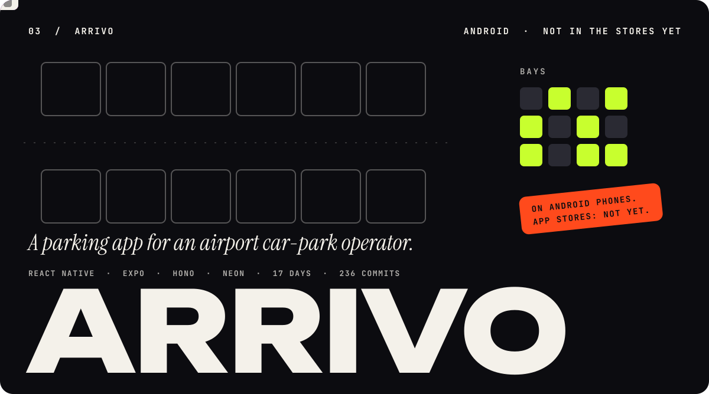

<a href="https://kanata.studio"></a>


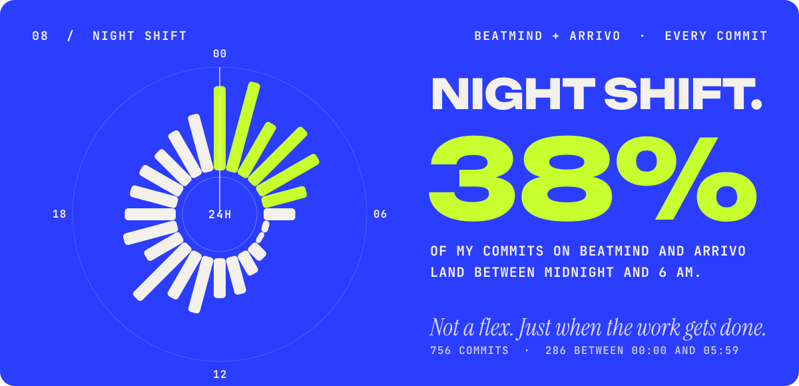

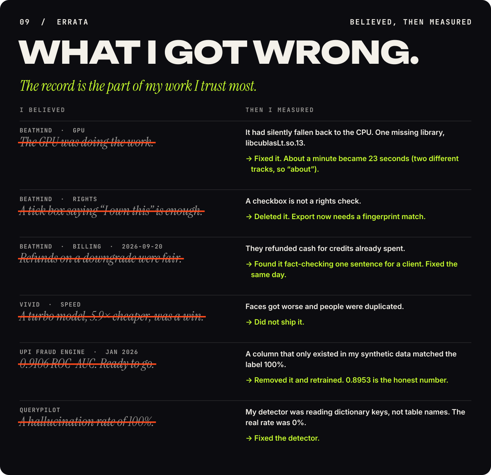

<b>Read the errata as text</b>

 

| Where | I believed | Then I measured | So I |
|---|---|---|---|
| **BeatMind**, GPU | The GPU was doing the work | It had silently fallen back to the CPU. One missing library, `libcublasLt.so.13` | Fixed it. About a minute became 23 seconds (two different tracks, so "about") |
| **BeatMind**, rights | A tick box saying "I own this" is enough | A checkbox is not a rights check | Deleted it. Export now needs a fingerprint match |
| **BeatMind**, billing, 2026-09-20 | Refunds on a downgrade were fair | They refunded cash for credits already spent | Found it fact-checking one sentence for a client. Fixed the same day |
| **Vivid**, speed | A "turbo" model, 5.9× cheaper, was a win | Faces got worse and people were duplicated | Did not ship it |
| **UPI Fraud Engine**, Jan 2026 | 0.9106 ROC-AUC, ready to go | A column that only existed in my synthetic data matched the label 100% | Removed it and retrained. 0.8953 is the honest number |
| **QueryPilot** | A hallucination rate of 100% | My detector was reading dictionary keys, not table names. The real rate was 0% | Fixed the detector |

<a href="https://github.com/parthtiwari-dev/querypilot">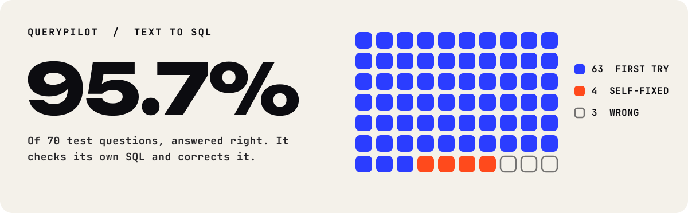</a>

<a href="https://github.com/parthtiwari-dev/upi-fraud-engine">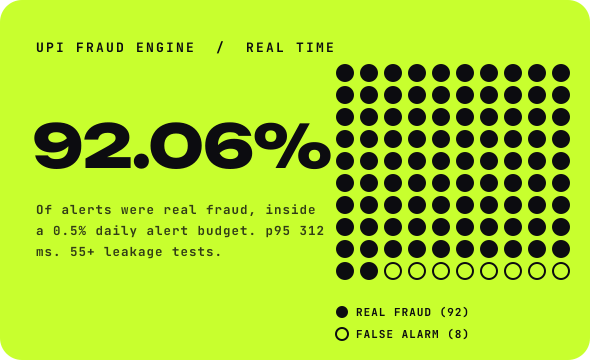</a>

<a href="https://github.com/parthtiwari-dev/Evidence-Bound-Drug-RAG">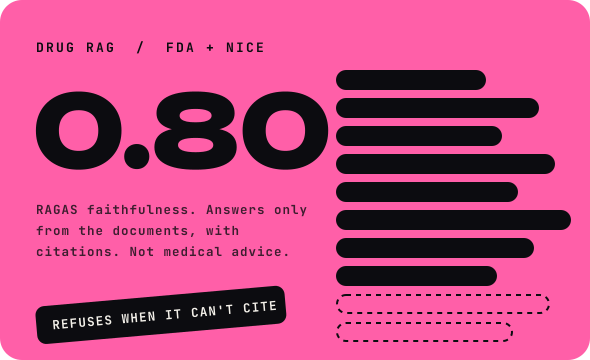</a>

<a href="https://github.com/parthtiwari-dev/tathya">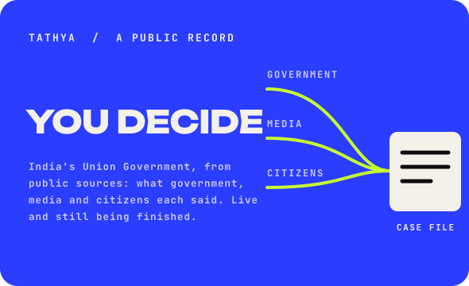</a>

<a href="https://tabla-tuner.vercel.app">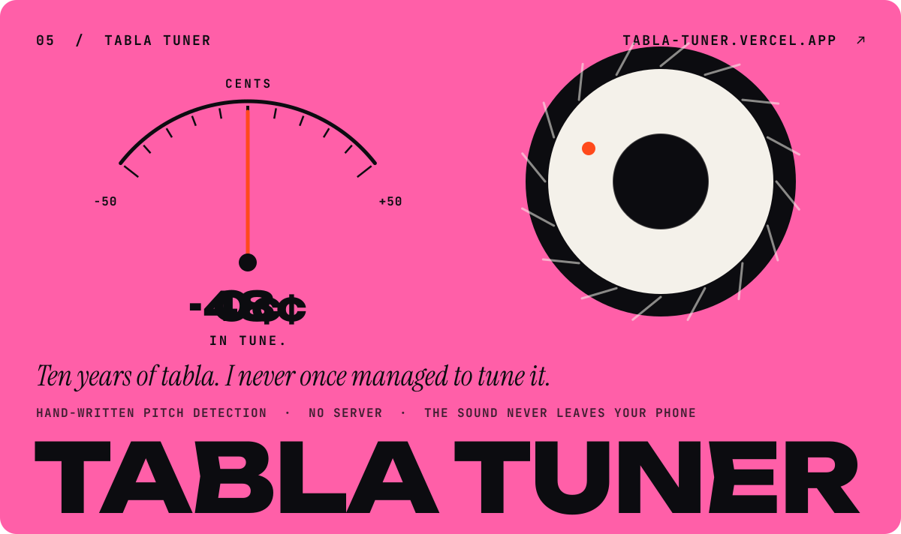</a>

<a href="https://from-zero-to-mozart.vercel.app">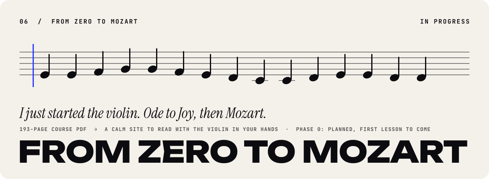</a>

<a href="mailto:parthti2003@gmail.com">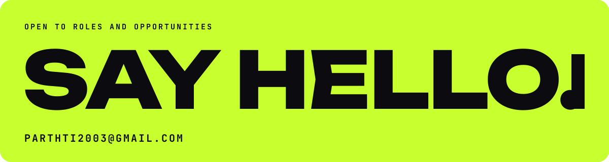</a>

